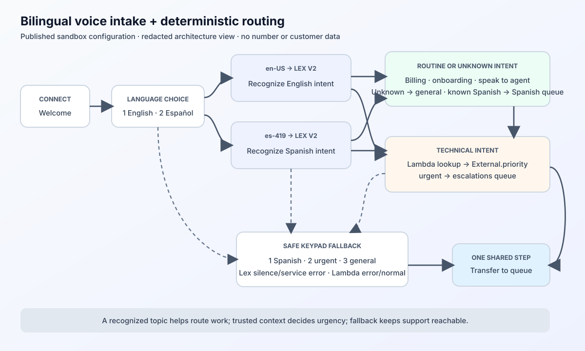
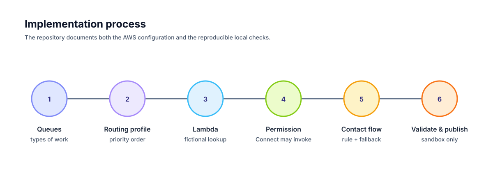

# Amazon Connect Routing Lab

> A documented Amazon Connect sandbox implementation for bilingual SaaS support routing — with a published Lex V2 voice layer, a deployed Node.js Lambda lookup, and a local TypeScript simulation.



## At a glance

| Area | What this project demonstrates | Evidence in this repository |
| --- | --- | --- |
| Amazon Connect | A published inbound flow, bilingual voice intent routing, three queues, a routing profile, and safe keypad fallback. | [Implementation map](docs/CONNECT_BUILD_MAP.md) and [deployment walkthrough](docs/DEPLOYMENT_WALKTHROUGH.md) |
| Amazon Lex V2 | A versioned bot alias with English and Spanish locales and four intents. | [Deployment walkthrough](docs/DEPLOYMENT_WALKTHROUGH.md) and [CLI flow builder](scripts/build-voice-flow.mjs) |
| AWS Lambda | A deployed synchronous lookup with a flat **STRING MAP** response. | [Handler](lambda/support-context-lookup/index.mjs) and [scenario runner](lambda/support-context-lookup/simulate.mjs) |
| Decision design | Technical intent invokes Lambda; `External.priority = urgent` bypasses the keypad and enters escalation. Routine intents route by language. | [Published-flow diagram](docs/assets/published-flow-routing.svg) and implementation map |
| Engineering evidence | Four repeatable fictional Lambda scenarios, plus a richer TypeScript routing model. | `npm run simulate:lambda` and `npm run simulate` |
| Safety boundary | No phone number, live calls, customer data, recordings, CRM, or DynamoDB. | [Sandbox scope](docs/DEPLOYMENT_WALKTHROUGH.md#what-is-and-is-not-in-the-aws-sandbox) |

The visual assets are redacted diagrams derived from the published configuration. They intentionally omit account identifiers, browser chrome, contact records, and secrets.

## The operational problem

Support teams lose time when callers repeat their context, priority cases enter the same queue as standard cases, and callback promises are not tracked. This project models a route that prioritizes an enterprise customer with an active technical incident while giving Spanish- and English-speaking customers an appropriate support path.

All customer profiles and contact IDs are fictional. No real customer information is processed and no calls are placed.

## Verified Amazon Connect configuration

The following base routing configuration is deployed and published in a personal Amazon Connect sandbox:

- An inbound flow asks for English or Spanish, then uses a Lex V2 voice prompt to recognize `TechnicalIncident`, `BillingHelp`, `OnboardingHelp`, or `SpeakToAgent`.
- Billing, onboarding, and agent requests route to general English support or Spanish support according to the chosen language. An unrecognized intent in either language goes to `general-support` for human triage; a Lex timeout or service error still uses the keypad menu.
- Three queues exist: `escalations`, `spanish-support`, and `general-support`.
- Each selection sets the working queue, then converges on one shared transfer-to-queue block.
- For technical intent, the flow invokes Lambda, then a published **Check contact attributes** block evaluates its returned `External.priority` value. `urgent` goes directly to escalation; normal, missing, or Lambda-error outcomes continue to the keypad menu.
- Every configuration-error branch ends safely instead of falling through to an undefined path.
- A routing profile prioritizes escalation work ahead of Spanish and general support, with one simultaneous voice contact per agent.

No phone number is claimed or associated with the flow. Therefore, the published configuration cannot receive outside calls and does not create telephony usage. The Lambda function is deployed, console-tested with a built-in fictional sample, approved for invocation by this Amazon Connect instance, and invoked synchronously on the technical-intent path. The flow passes no customer identifier, so the handler returns its safe `priority: normal` fallback and the check takes the menu path. The project has not connected DynamoDB, Contact Control Panel integrations, callbacks, recordings, or customer data. The live flow configuration was read back from AWS after its CLI update and matched the generated candidate exactly; no end-to-end voice call was performed.

## What the simulation represents

| Local component | Equivalent AWS component | Responsibility |
| --- | --- | --- |
| `simulate.ts` | Test inbound call | Supplies fictional caller context and IVR choices. |
| `route-contact.ts` | Future contact-flow enrichment | Applies the richer account-context routing rules and creates contact attributes. |
| `lambda/support-context-lookup/index.mjs` | Deployed AWS Lambda | Returns simple fictional account attributes and a safe normal-priority fallback. |
| `customer-directory.ts` | Future DynamoDB-backed lookup | Retrieves a fictional customer profile in the richer local model. |
| `auditTrail` | CloudWatch contact-flow logs | Records why the call took a particular route. |
| `agentHandoff` | CCP attributes / agent screen pop | Gives the agent the context needed to start well. |

## Architecture

The published flow follows this fault-tolerant sequence:

1. A welcome prompt sets expectations.
2. A language choice sets the Connect contact language to `en-US` or `es-419` before invoking the corresponding Lex voice prompt.
3. Lex identifies technical, billing, onboarding, or agent intent. Routine requests go to the language-appropriate queue.
4. Technical intent invokes Lambda, then the flow checks `External.priority`.
5. Only `urgent` proceeds straight to `escalations`. A normal or missing priority — and any Lambda error — preserves the three-option keypad menu.
6. Every queue branch converges on one transfer-to-queue block. Unrecognized intent uses general support; language-choice errors, Lex timeouts/service errors, and Lambda failures retain the keypad fallback.

This pattern matters because it makes automation helpful without making it a single point of failure. A lookup failure should not prevent a caller from choosing support.



## Run locally

From this folder, install the project-only development dependency once:

```bash
npm install
npm run check
npm run simulate
npm run simulate:lambda
```

For a fresh clone, run `npm install` once before using any of the scripts above.

## Test scenarios

1. `CUST-100`: Enterprise + active technical incident → `escalations`, urgent.
2. `CUST-200`: Standard Spanish billing question + callback → `spanish-support`, callback position retained.
3. Unknown English caller → safe default `general-support` route.

## Portfolio evidence

The project includes the non-code artifacts expected in a contact-center implementation discussion:

- [Amazon Connect implementation map](docs/CONNECT_BUILD_MAP.md): separates verified Connect configuration from planned enrichment services.
- [Deployment walkthrough](docs/DEPLOYMENT_WALKTHROUGH.md): step-by-step explanation of the AWS build, each architectural decision, and the current sandbox boundary.
- [Demo runbook](docs/DEMO_RUNBOOK.md): three test scenarios and a 90-second portfolio-video outline.
- [Portfolio positioning](docs/PORTFOLIO_POSITIONING.md): accurate language for a CV, LinkedIn post, or interview.
- [Lambda handler](lambda/support-context-lookup/index.mjs): deployed Node.js handler using only two fictional customer records; no environment variables or secrets.
- [Lambda scenarios](lambda/support-context-lookup/simulate.mjs): validates the Connect event shape, urgent route input, standard input, unknown-caller fallback, and the published-flow fallback locally.
- [CLI flow builder](scripts/build-voice-flow.mjs): reads the published flow and Lex alias, validates every branch, and writes an ignored candidate plus rollback copy before a separate deployment command.
- [Lex no-match migration](scripts/route-unknown-lex-to-general.mjs): makes the small, reviewable change from the original keypad fallback to human general-support triage for unknown intent.
- Agent-workspace preview: run `node dist/agent-workspace-preview.js` after building to see the agent handoff created for an urgent call.

## What is intentionally not claimed

The published Amazon Connect flow is a sandbox deployment, not a production contact center. This project does not claim that outside calls, end-to-end voice recognition, the Contact Control Panel, DynamoDB, recordings, or callbacks were executed in AWS. The Lambda handler is deployed, console-tested, approved for use by the Connect instance, and its returned `priority` is evaluated by a published flow decision on the technical-intent path. It has not been exercised by an outside call; with no customer identifier in this sandbox, it deliberately returns its safe normal fallback. The richer account lookup remains an implementation-ready local model.

## Learning goals

- A **contact flow** is a decision process for an incoming call.
- **Contact attributes** are small pieces of context passed between the flow and the agent.
- A **Lambda lookup** adds data to a call before choosing a route.
- Routing criteria turn operational rules—such as language or urgency—into a queue decision.
- Audit logs make routing explainable and diagnosable.

## Repository structure

```text
amazon-connect-routing-lab/
├── docs/
│   ├── assets/                         # Redacted visual walkthroughs
│   ├── CONNECT_BUILD_MAP.md            # Verified AWS configuration vs. planned work
│   ├── DEPLOYMENT_WALKTHROUGH.md       # Build process and technical explanation
│   ├── DEMO_RUNBOOK.md                 # Repeatable interview/video demo
│   └── PORTFOLIO_POSITIONING.md        # Accurate resume and LinkedIn wording
├── lambda/support-context-lookup/      # Deployed Node.js Lambda and local scenarios
├── scripts/build-voice-flow.mjs          # Reproducible CLI candidate builder
├── scripts/route-unknown-lex-to-general.mjs # Existing-flow no-match migration
└── src/                                # TypeScript model for richer future behavior
```
