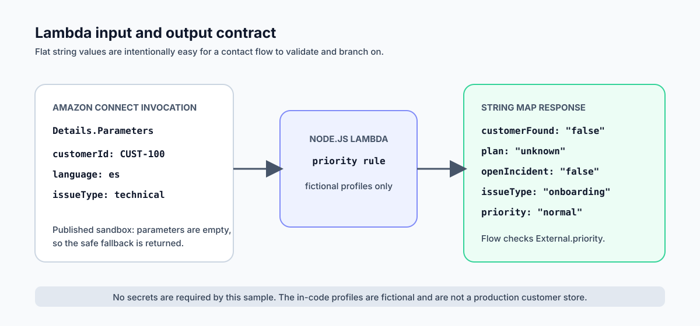

# Deployment walkthrough

This document explains the Amazon Connect Routing Lab as an implementation story, not just a collection of services. It separates the work that is deployed in an AWS sandbox from the richer local TypeScript model used to demonstrate future capabilities.


## The customer-support problem

An ordinary phone tree can collect a caller's language and reason for calling, but it cannot reliably distinguish an urgent customer-impacting incident from a routine request. If every technical caller goes to the same queue, a known enterprise incident can wait behind routine work. If the data lookup fails and the flow disconnects the caller, the automation creates a worse experience than no automation at all.

This lab implements a narrow, explainable rule:

```text
When a validated lookup returns priority = urgent,
send the contact to the escalation queue.

Otherwise, let the caller choose their support path from the normal keypad menu.
```

That is deliberately more conservative than letting the lookup silently decide every customer path.

## What is and is not in the AWS sandbox

| Deployed and published | Intentionally not enabled |
| --- | --- |
| Amazon Connect inbound contact flow | Phone number or external calling |
| `escalations`, `spanish-support`, and `general-support` queues | Real customer records or CRM integration |
| Escalation-first routing profile | DynamoDB, recordings, callbacks, or CCP customization |
| Node.js Lambda with fictional profiles | Secrets, environment variables, or personal data |
| Synchronous Lambda invocation and `External.priority` check | Production traffic or production service claims |

The absence of a phone number is an important cost and safety control: the published flow has no outside callers and cannot create telephony usage through a live number.

## Build sequence

### 1. Model the work with queues

The queues represent types of support work, not individual people:

| Queue | Operational purpose |
| --- | --- |
| `escalations` | High-impact technical incidents that need rapid ownership. |
| `spanish-support` | Requests where Spanish language support is the primary need. |
| `general-support` | Standard English or general requests. |

The routing profile ranks escalation work ahead of Spanish and general support. It is configured for one simultaneous voice contact, which makes the lab easy to explain without implying a production staffing model.

### 2. Build a safe base contact flow

The contact flow starts with a welcome prompt and a DTMF menu:

| Key | Caller path | Queue set by the flow |
| --- | --- | --- |
| `1` | Spanish support | `spanish-support` |
| `2` | Urgent technical incident | `escalations` |
| `3` | General support | `general-support` |

Each branch sets a working queue and then meets at one shared transfer-to-queue block. This removes duplicated transfer logic: if a transfer setting changes, there is only one place to update it.

### 3. Add an enrichment function

The deployed Lambda is intentionally small. It accepts configured values beneath `Details.Parameters` and returns only a flat map of strings, which is compatible with Amazon Connect's **STRING MAP** response validation.



Why flat strings? Contact flows are strongest when their decision data is predictable. A small value such as `priority: "urgent"` is easier to validate, log, and branch on than a nested application payload.

### 4. Permit and invoke the Lambda from Amazon Connect

Amazon Connect must be explicitly allowed to use a Lambda function before a contact-flow block can invoke it. The configured block is synchronous: Connect waits for the result before it follows the next branch. That is appropriate here because priority context influences the next routing decision.

The function's built-in profiles are fictional. The deployed flow currently sends no customer identifier, so the handler returns its safe fallback:

```json
{
  "customerFound": "false",
  "plan": "unknown",
  "openIncident": "false",
  "language": "en",
  "issueType": "onboarding",
  "priority": "normal"
}
```

### 5. Turn the returned value into an explicit decision

The published **Check contact attributes** block evaluates this exact condition:

```text
Namespace: External
Key:       priority
Operator:  Equals
Value:     urgent
```

`External` means the value came from the immediately preceding Lambda invocation. It is not a database name and it is not an environment variable.

The two outcomes are wired as follows:

| Branch | Destination | Why |
| --- | --- | --- |
| `= urgent` | Set escalation queue → shared transfer block | Known urgent cases should not wait for the keypad. |
| `No Match` | Existing three-option keypad menu | Normal or missing context should retain caller choice. |
| Lambda `Error` | Existing three-option keypad menu | A dependency failure must not strand the caller. |

### 6. Save, publish, and validate

Saving creates a draft version; publishing is the action that makes that version active in the sandbox. The flow was saved and published after each branch had a destination.

Local validation complements the console configuration:

```bash
npm install
npm run simulate:lambda
npm run simulate
```

`simulate:lambda` verifies four fictional cases:

1. Enterprise customer + open technical incident → `urgent`.
2. Standard Spanish billing request → `normal`.
3. Unknown caller → safe `normal` fallback.
4. The no-parameter shape used by the published sandbox flow → safe `normal` fallback.

## Why the fallback is a design requirement

The lookup is an aid to routing, not a gatekeeper for support. If a future data source is slow, unavailable, or incomplete, the caller can still select the correct queue. This is an example of graceful degradation: the experience loses optional context, but it retains the essential customer path.

## How this would progress responsibly

Before making this a live system, the next work would be:

1. Define an approved, minimal source for customer context.
2. Pass only the required fields to Lambda; avoid free-form problem descriptions and personal data.
3. Retain the explicit, audited `priority` rule rather than hiding routing logic in code.
4. Map only approved attributes to an agent workspace.
5. Test with a temporary number during a scheduled window, then release it.
6. Add least-privilege permissions and data-retention controls before production use.

## Recruiter-friendly summary

> Built and published an Amazon Connect sandbox flow for bilingual SaaS support. Configured queues and priority agent routing, deployed a Node.js Lambda lookup with fictional data, and used a validated returned priority attribute to send urgent cases to escalation while preserving a safe IVR fallback. No customer data or live calls were used.

For exact claims and interview language, see [Portfolio positioning](PORTFOLIO_POSITIONING.md).
